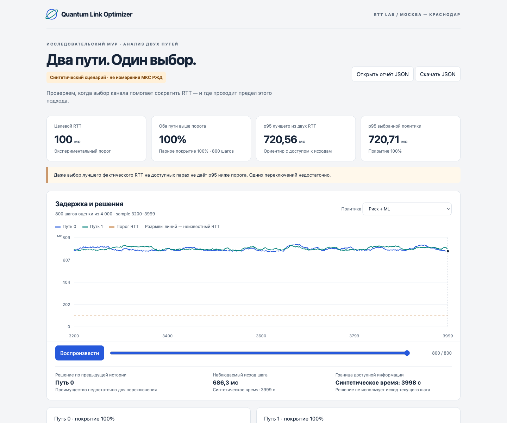

# Quantum Link Optimizer

**Исследовательский MVP · Python 3.12–3.13 · PyTorch / CPU · Apache 2.0**

Анализ ping RTT двух путей, сравнение алгоритмов выбора канала и интерактивное
воспроизведение решений. От измерений — к проверяемому ответу: помогает ли
переключение между существующими путями приблизиться к целевым 100 мс?

Контекст проекта — **Москва — Краснодар, МКС РЖД**. По данным постановщика,
длительные ping-измерения дают около 700 мс RTT. Исходные пробы целевых путей
пока не предоставлены. MVP готов для демонстрации на маркированной синтетике
и анализа внешнего CSV; снижение реальных 700 → 100 мс пока не подтверждено.

[Запуск и данные](docs/mvp.md) · [Исследование задачи](docs/research-and-mvp.md) ·
[Контекст МКС РЖД](docs/rzd-network-context.md) · [Источники](docs/data-sources.md)



## Быстрый запуск

Нужны Python 3.12 или 3.13 и [uv](https://docs.astral.sh/uv/). GPU, Node.js
и отдельный веб-сервер для работы MVP не требуются.

```bash
git clone https://github.com/g-kek/quantum-link-optimizer.git
cd quantum-link-optimizer
uv sync --locked --python 3.12
uv run quantum-link demo --output artifacts/demo
```

Откройте `artifacts/demo/index.html` в браузере. До публикации локальных
коммитов этот запуск доступен в подготовленном локальном `main`;
удалённый `origin/main` ещё содержит исходную версию репозитория.

По умолчанию демонстрация генерирует 4000 измерений со значениями около
700 мс, обучает небольшую модель на CPU и проверяет решения на последних 20%
ряда. Сценарий `high-rtt` добавляет 625 мс к базовому генератору — это
иллюстрация ограничения метода, а не модель физики или измерения МКС РЖД.

Для сценария с задержками вблизи порога:

```bash
uv run quantum-link demo --scenario normal --output artifacts/demo-normal
```

## Что можно показать

- График RTT обоих путей, порог и пошаговое воспроизведение выбора.
- Сравнение fixed-path, previous RTT, EWMA, прогноза ML и выбора с учётом риска.
- Одинаковые ограничения удержания и переключений для сопоставимых политик.
- Mean, p95/p99, долю превышений, покрытие измерений, отказы и переключения.
- Предел выбора: долю доступных пар, где **оба пути** выше порога.
- Происхождение данных, параметры запуска и экспорт JSON.

Отчёт работает локально без CDN и сетевых запросов. Кнопка «Открыть отчёт JSON»
загружает другой результат `demo` или `audit` без повторного обучения.

## Анализ собственных ping-измерений

```bash
uv run quantum-link audit \
  --input data/ping.csv \
  --output artifacts/ping-audit
```

CSV в длинном формате, UTF-8, с точным порядком колонок:

```text
sample,timestamp,path,status,rtt_ms,source,provenance
```

Одна строка на путь и момент измерения. `path` — 0/1; `status` —
`ok`/`timeout`/`missing`; RTT — в мс только при `ok`. Timestamp содержит
часовой пояс; два пути одного sample имеют общее время. `source` —
`real_telemetry` либо `ripe_atlas`, `provenance` описывает источник и метод.
Сырые времена проб следует сохранять при подготовке парного набора.

`audit` не обучает модель и не переносит на измерения модель из синтетики.
Он сравнивает простые причинные политики и показывает достижимость на
доступных парах. Тайм-ауты и пропуски сохраняются; неизвестный RTT не считается
успешной доставкой. По умолчанию история старше 2 секунд считается устаревшей:
при другой частоте проб задайте `--max-gap-seconds`.

Подробная [схема входа и трактовка метрик](docs/mvp.md#внешняя-телеметрия).

## Артефакты

| Файл / каталог | Содержимое |
| --- | --- |
| `index.html` | Переносимый интерактивный отчёт |
| `report.json` | Метрики, временной ряд, решения и сведения о запуске |
| `experiment/` | Только demo: телеметрия, веса, прогнозы, протоколы оценки |
| `experiment/replay/shadow.jsonl` | Только demo: решения перед раскрытием исходов |

Повторный запуск в тот же каталог перезаписывает результаты.
Веса и исходные данные исключены из Git.

## Методика и ограничения

Для обучения используются временные train/validation/test 60/20/20,
нормализация только по train и удаление целевых окон, пересекающих границы.
Replay использует сохранённые веса; решения сверяются с пакетной оценкой.
Oracle имеет доступ к фактическим исходам и служит только ориентиром.

На текущей синтетике преимущество ML для выбора пути не установлено.
В базовом RTT-эксперименте seed 42 выбор по последнему RTT даёт среднее
75.333 мс, MLP — 75.367 мс; у обоих доля RTT >100 мс равна 2.625%.
Сравнение с EWMA и политиками с одинаковым удержанием доступно в новом отчёте.

Если оба пути медленнее 100 мс, один выбор между ними не создаст быстрый путь.
Стоимость переключения в расчёте условная; реальные простои и изменение
нагрузки ещё не измерены. Программа не управляет оборудованием.
Ping RTT не оценивает QBER, скорость получения ключей или точность boundary
clocks. QKD и PTP остаются контекстом исследования, а не физической моделью.

## Дополнительные команды

```bash
uv run quantum-link experiment --output artifacts/forecast
uv run quantum-link warning-experiment --output artifacts/warning
uv run quantum-link risk-experiment --output artifacts/risk
uv run quantum-link benchmark-suite --output artifacts/benchmark
uv run quantum-link --help
```

Описание отдельных экспериментов: [RTT](docs/experiment-methodology.md),
[предупреждения](docs/early-warning.md), [выбор пути](docs/risk-selection.md),
[shadow replay и Atlas](docs/shadow-replay.md).

## Разработка

```bash
uv run pytest -q
uv run ruff check .
uv run ruff format --check .
uv build --wheel
```

Код находится в `src/quantum_link_optimizer/`, тесты — в `tests/`.
HTML-шаблон поставляется внутри Python-пакета. CI проверяет Python 3.12/3.13.
Рабочая основа теперь собрана в `main`; ветки `feat/telemetry-foundation`,
`feat/rtt-forecasting`, `feat/degradation-warning`, `feat/risk-aware-selection`
и `feat/shadow-replay` сохраняют историю этапов.

Следующий этап — парная телеметрия целевых путей, подтверждение интерфейса
переключения и shadow-пилот на независимом периоде.
[Инструкция для разработчика](CONTRIBUTING.md) · [Изменения](CHANGELOG.md).

## Лицензия

[Apache 2.0](LICENSE).
