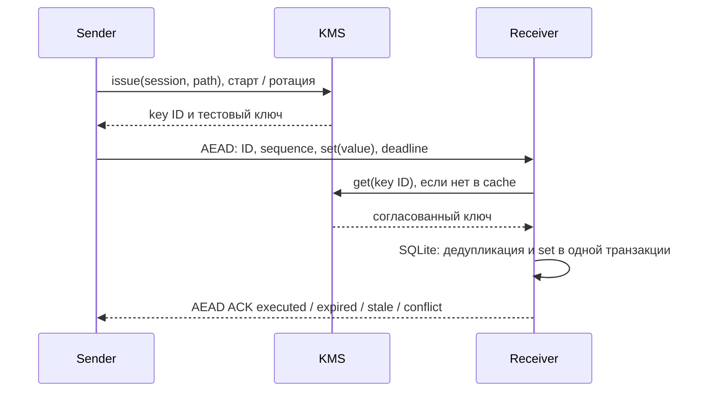

# Команды по фиксированному A/B



## Запуск на MacBook без VM

```bash
uv sync --extra lab
mkdir -p artifacts/commands
```

Три терминала из корня репозитория (для повторов нужны новые файлы журналов):

```bash
uv run --extra lab python -m quantum_link_optimizer.kms \
  --config lab/kms/normal.json --events artifacts/commands/kms.jsonl
```

```bash
uv run --extra lab python -m quantum_link_optimizer.commands receive \
  --events artifacts/commands/receiver.jsonl --state artifacts/commands/state.sqlite
```

```bash
uv run --extra lab python -m quantum_link_optimizer.commands send \
  --path A --remote 127.0.0.1:9501 --count 20 --rotate-after 5 \
  --events artifacts/commands/sender.jsonl
```

Для B: `--path B --remote 127.0.0.1:9502`. Оба приёмных сокета отдельные.
Время сессии и ID команды записываются в журнал. При повторе запуска receiver
с тем же SQLite сохраняется дедупликация; новый sender создаёт новую сессию.

## В namespaces Linux

После установки `cryptography` в интерпретаторе Linux runner:

```bash
sudo env PYTHONPATH=src python3 -m quantum_link_optimizer.lab run \
  --config lab/scenarios/commands-a.json --output artifacts/lab/commands-a-01
```

| Конфиг | Проверка |
| --- | --- |
| `commands-a.json` / `commands-b.json` | Команды и ACK по фиксированной ветви |
| `commands-slow-kms.json` | Здоровая сеть, ожидание выдачи ключа |
| `commands-empty-kms.json` | Истечение дедлайна во время ожидания KMS |

KMS живёт в отдельном namespace с двумя служебными veth к sender/receiver.
Он не проходит через netem ветвей. PCAP фильтруется по ICMP/UDP и исключает
служебный TCP API с тестовыми ключами. Сервис не имеет внешнего интерфейса.

## Семантика и ограничения

- Команда — идемпотентный `set(value)` с монотонным sequence внутри сессии.
  Старые новые команды получают `stale`; пропуски sequence разрешены.
- ACK `executed` подтверждает транзакцию тестового состояния SQLite.
  Это не гарантия exactly-once для произвольного внешнего оборудования.
- Повтор сохраняет ID, deadline и тело. Поздняя копия исполненного запроса
  получает сохранённый результат, а не повторное исполнение.
- Без ACK исход `unknown`: отсутствие ответа не доказывает отсутствие исполнения.
- Дедлайн включает очередь отправителя, начальную выдачу и обязательную ротацию.
  В журнале `session_ready` разделены startup, steady и rotation.
- Дедлайн на receiver использует общие monotonic-часы одной VM/хоста.
  На разных физических хостах нужна отдельная модель часов.
- Очереди sender/receiver конечны. Нет тихого перехода на незашифрованный обмен.
- AEAD: ChaCha20-Poly1305 из `cryptography`, HKDF разделяет ключи command/ACK,
  каждый пакет имеет случайный 96-битный nonce. Заголовок аутентифицируется.
  Это лабораторный протокол, не аттестованный криптошлюз и не реализация QKD.
- Лимит **всего UDP payload** 1200 байт, включая JSON/base64/AEAD.
  Для IPv4 без options нужен MTU хотя бы 1228; при туннелях вычитаем их заголовки.
  Фактический MTU записан в snapshot. Jumbo/туннели требуют отдельной проверки.
- KMS после рестарта теряет тестовые ключи: receiver возвращается к работе
  после новой выдачи/ротации. SQLite сохраняет дедупликацию до удаления базы.

Проверки: `uv run --extra lab pytest -q tests/commands tests/kms`.
Покрыты реальный TCP KMS + UDP, потеря ACK, повтор, ротация, restart состояния,
поздняя команда, порядок, конфликт ID, аутентификация, MTU-бюджет и очереди.
Linux-интеграция требует VM; она ещё не проверена из-за нехватки дискового места.

Источники: [AEAD](https://cryptography.io/en/latest/hazmat/primitives/aead/),
[HKDF](https://cryptography.io/en/latest/hazmat/primitives/key-derivation-functions/).

## Дедупликация A/B

Логическая сессия общая для команды на обоих путях; ключевые сессии различаются:
`<logical-id>/A` и `<logical-id>/B`. Получатель выводит логический ID из
аутентифицированной ключевой сессии, а не из произвольного поля команды.
SQLite атомарно проверяет `(logical session, command ID)` и меняет состояние.
Одинаковое тело с тем же дедлайном возвращает сохранённый результат даже после
смены пути/рестарта; другое тело с тем же ID — `conflict`. ACK привязан к хешу
полного запроса. Для копий используется `Sender.submit(body)` с одним заранее
созданным телом; повторный вызов `send()` создаёт новый дедлайн.

Wire-протокол обновлён до v2: старые агенты нужно обновить одновременно.
Сохранённые записи SQLite остаются; старые несвязанные ключевые сессии не
принимаются новыми получателями. KMS остаётся доверенным лабораторным сервисом,
эта схема не добавляет изоляцию клиентов и аутентификацию API KMS.
