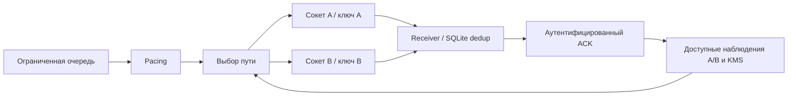
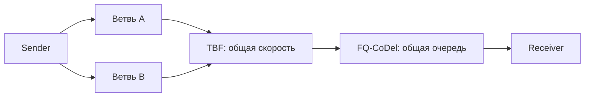

# Выбор пути и ограниченные копии

[Issue #5](https://github.com/g-kek/quantum-link-optimizer/issues/5).
Политики: `fixed-a`, `fixed-b`, `last`, `ewma`. Это правила без ML.



- EWMA: α=0.3; гистерезис и минимальное удержание. Аварийный переход обходит
  удержание после наблюдаемого отказа, серии timeout или ошибки KMS.
- Учитываются возраст RTT, доступность устройства, готовность ключа и измеренная
  стоимость его получения. `require_clock` требует свежего признака пригодности BC.
  Истинные причины из `truth*.jsonl` контроллеру не передаются.
- Одна логическая команда имеет общий ID, тело и дедлайн для A/B. Ожидания
  очереди, pacing, ключа и ротации входят во время операции.
- Вторая ветвь запускается после `hedge_delay_ms` только при `allow_copy=true`
  для разрешённых идемпотентных тестовых `set`. Для команды можно запретить копию.
  Максимум две ветви; число попыток каждой ограничено. Первый успешный ACK
  отменяет остальные ожидания и повторы; уже отправленный пакет может дойти позже.
- Лимит дополнительных байтов действует на команду и весь запуск. Считаются
  UDP payload + 28 байт IPv4/UDP каждой попытки копии; ACK, Ethernet и пробы
  в этот лимит не входят. Расход ключей: одно использование при `Session.acquire`
  на ветвь команды; повторы используют тот же ключ. Копия может открыть отдельную
  сессию и потратить единицу пула; новый ключ не выдаётся на каждый пакет.
- При замедлении обеих ветвей или наблюдаемой общей очереди копия подавляется.
  Потеря ACK означает `outcome=unknown`, даже если исполнение могло состояться.

## Запуск на macOS

Реальные UDP-сокеты, TCP KMS и управляемые программные очереди; root не нужен.

```bash
uv sync --extra lab
uv run python -m quantum_link_optimizer.selection \
  --plan lab/selection/comparison.json --output artifacts/selection/compare-01
uv run python -m quantum_link_optimizer.selection \
  --plan lab/selection/shared-queue.json --output artifacts/selection/queue-01
uv run pytest -q
```

Каждый запуск — в новый каталог. `smoke.json` даёт короткую проверку.
Сравнение использует только train/validation, final test остаётся отложенным.
`comparison.json/.md`, `routing-summary.json`, события и manifest с конфигурацией,
версиями, seed, исходниками и хешами сохраняются рядом.

## Namespace/veth и FQ-CoDel

В подготовленной [Linux VM](../lab/network.md), из корня проекта:

```bash
uv sync --extra lab
sudo modprobe sch_fq_codel
sudo env PYTHONPATH=src .venv/bin/python -m quantum_link_optimizer.lab run \
  --config lab/scenarios/online-selection.json --output artifacts/lab/online-01
sudo env PYTHONPATH=src .venv/bin/python -m quantum_link_optimizer.lab run \
  --config lab/scenarios/shared-fq-codel.json --output artifacts/lab/fq-01
sudo env PYTHONPATH=src .venv/bin/python -m pytest -q tests/lab
```



`online-selection.json` передаёт команды и пробы по настоящим маршрутам A/B.
`shared-fq-codel.json` создаёт общий ограниченный участок с фоновым iperf3.
FQ-CoDel включается `queue_discipline: fq_codel` на rate-only интерфейсе;
netem delay/loss/reorder задаются на других звеньях. Очередь и маршруты проверяются
через `tc -j`, capture и Linux-тесты; workflow `Linux packet lab` запускает их с root.

## Сценарии и проверка результата

| План | Проверка |
| --- | --- |
| `comparison.json`: recoverable-700 | A≈700 мс, B≈60 мс; сравнение fixed A/B, last, EWMA, hedging |
| `comparison.json`: common-700 | Обе ветви≈700 мс; переключение не устраняет общий предел |
| `shared-queue.json` | Общая деградация скорости; EWMA / pacing / копии, одинаковая входная нагрузка |

Локальный прогон: recoverable-700 — fixed A 0/11 подтверждений ≤100 мс,
fixed B, last и EWMA 11/11; common-700 — 0/11 у всех политик.
На общей очереди копии добавили 1328 байт без улучшения числа подтверждений
≤100 мс; pacing 1 команда/с также не улучшил результат при данной нагрузке.
Это короткая функциональная проверка, а не статистическая оценка преимуществ.

Диагноз находится в `route_decision`: основания, возраст наблюдений, альтернативы
и `not_established`, когда причинность не установлена. Отдельно видны очередь
отправителя, A/B, общая деградация, очередь/обработка receiver из AEAD ACK и
ожидание KMS. Проверять также missing completions, unknown outcomes,
duplicate executions, байты и `keys_delivered` / `key_policy_uses`.

Числа задержек, деградации, BC, пороги выбора и диагностики — **допущения**,
не параметры реального оборудования. Пороги сигналов: KMS >10 мс, receiver
>1 мс. BC не меняет системные часы; пригодность BC не выводится из RTT.
700→100 мс достижимо только при доступной быстрой ветви и достаточных ключах.

Механизмы для сопоставления: [gRPC hedging](https://grpc.io/docs/guides/request-hedging/),
[FQ-CoDel](https://www.man7.org/linux/man-pages/man8/tc-fq_codel.8.html).

Проверено: macOS — 157 тестов, 6 Linux-only пропусков; Ruff и wheel прошли.
В [Linux CI](https://github.com/g-kek/quantum-link-optimizer/actions/runs/42096525539)
с root прошли все 31 тест из `tests/lab`, включая реальные маршруты,
FQ-CoDel и онлайн-отправитель. Короткий `smoke.json` также выполнен после коммита.

## Дополнительная приёмка 7 ноября 2026

[Приёмка issue #1–5](../validation/acceptance.md): реальные эффекты сетевых сценариев
с тремя повторами, диагностика свежих/устаревших наблюдений и ссылки на CI.
Исправлены восстановление обратного маршрута после down/up и использование
устаревших оснований диагноза. Стенд прогревает соседей до внесения netem.
