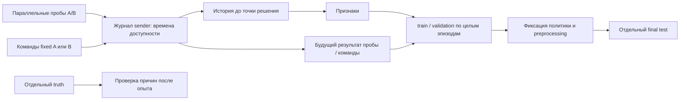
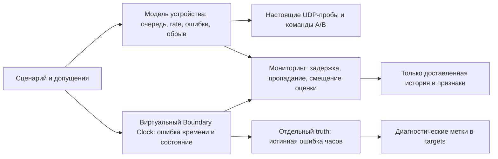

# Датасет оптимизатора: RTT около 700 мс, цель 100 мс

Данные лабораторные. Реальные измерения целевой сети пока не предоставлены.
Сборщик использует настоящие TCP/UDP-сокеты на MacBook, две параллельные ветви
и программный relay. Он не воспроизводит физическую QKD и очереди Linux.

## Условие 700 → 100

| Профиль | Заданные условия | Что проверяем |
| --- | --- | --- |
| `recoverable-700` | A: RTT 700 мс, B: 60 мс | Выбор B потенциально укладывается в 100 мс; fixed B — обязательный конкурент |
| `swap-700` | A/B меняются ролями в середине | Помогает ли причинное переключение относительно обоих fixed |
| `common-700` | Оба RTT 700 мс | Отрицательный контроль: выбор A/B не создаёт путь 100 мс |
| `reverse-700` | A: 30 мс туда, 670 обратно | Отличаем плохой обратный путь |
| `slow-kms` | Оба RTT 60 мс, выдача ключа 150 мс | Быстрая сеть не гарантирует команду за 100 мс |
| `loss-a` | RTT 60 мс, потери A 10% | Тайм-ауты, пропуски и качество доставки |

700 мс задаются **на весь RTT**, а не в каждую сторону. Постоянный delay —
сценарное допущение, не доказанная причина исходных 700 мс. Наличие реального
пути 60 мс тоже пока не подтверждено. Для переноса на сеть нужны её измерения.

Метрики разделены: RTT проб и время команды от поступления до ACK `executed`,
включая очередь, старт сессии и ротацию. Успех команды — ACK исполнения за
100 мс; для фиксации медленных исходов рабочий timeout составляет 2 с.
Пробы используют UDP echo, не ICMP. Их размеры и поведение отличаются от команд.

## Серии и запуск

```bash
uv sync --extra lab
uv run python -m quantum_link_optimizer.collection plan --plan lab/datasets/high-rtt.json
uv run python -m quantum_link_optimizer.collection collect \
  --plan lab/datasets/high-rtt.json --splits train validation --output artifacts/datasets/development
uv run python -m quantum_link_optimizer.collection build \
  --series artifacts/datasets/development --output artifacts/datasets/features
```

Полный план: **144 эпизода по 600 с**, примерно 24 часа измерений:
72 train, 24 validation, 48 final test. По два fixed-режима A/B, шесть профилей,
разные seeds и интервалы проб. Первые две выборки занимают около 16 часов.
Нужно заранее выделить место под журналы: объём зависит от повторов/потерь;
сборщик останавливается перед следующим эпизодом, если свободно менее 256 МиБ.

Для проверки замените план на `lab/datasets/smoke.json`: это короткий тест
конвейера, не полноценный обучающий набор. Выходной каталог должен быть новым.
Прерванную серию продолжайте той же командой с `--resume`: проверяются параметры
и хеши завершённых эпизодов. Повреждённый/незавершённый эпизод не переиспользуется;
для пересбора используйте новый каталог. `--allow-partial` при build предназначен
для отладки; такой датасет помечен `complete: false` и не допускается к freeze.

## Признаки и метки



Строка — кандидат A или B в общей точке решения. Пара имеет один episode/sample.
`features`: последние RTT, EWMA, timeout/missing fraction, возраст и устаревание
истории, последнее наблюдаемое ожидание ключа, возраст этого наблюдения,
локальная очередь отправителя. Сигналы KMS берутся из локального `session_ready`;
внутренние журналы KMS/receiver и truth в признаки не входят.

`targets` хранят RTT новой пробы, timeout/missing, время доступности результата,
а также статус/длительность команды **только на фактически выбранной ветви**.
Исход команды на альтернативной ветви остаётся `null`. Пропуски и тайм-ауты не
превращаются в нулевой RTT. `feature_available_ns <= decision_ns` проверяется.
Вход модели — только `features`, идентификаторы/профиль/targets не признаки.

Результаты: `train.jsonl`, `validation.jsonl`, `preprocessing.json`, `quality.json`,
`feasibility.json`, manifest с хешами и ссылками на исходные эпизоды.
Preprocessing обучается только на train: медианы заполнения, mean/scale;
`transform()` добавляет индикаторы отсутствия. Экспорт идёт по эпизодам;
для статистик хранятся компактные числовые столбцы, не весь набор JSON-объектов.

`feasibility.json` отдельно по split/профилю сравнивает fixed A/B, причинный EWMA
и явно обозначенную oracle-границу с доступом к будущим меткам. Показываются
покрытие, доля ≤100 мс, среднее/p95/p99 успешных проб и доля пар, где оба пути
медленные. Это replay проб, не доказательство улучшения доставки команд:
выбранную политику затем нужно реально запустить с теми же ограничениями.

## Финальный тест

Seeds train/validation/final не пересекаются. Интервалы final — 0,08/0,25 с,
train — 0,1/0,2 с, validation — 0,15 с. Эпизоды не делятся случайными строками;
история сбрасывается на границе эпизода. Стартовая часть не скрывается из метрик.

После выбора политики сохраните её параметры/веса в файл и зафиксируйте:

```bash
uv run python -m quantum_link_optimizer.collection freeze \
  --dataset artifacts/datasets/features --policy path/to/policy-file --output artifacts/policy-lock.json
uv run python -m quantum_link_optimizer.collection collect \
  --plan lab/datasets/high-rtt.json --splits final_test \
  --frozen-policy artifacts/policy-lock.json --output artifacts/datasets/final-series
uv run python -m quantum_link_optimizer.collection build \
  --series artifacts/datasets/final-series --output artifacts/datasets/final-features \
  --preprocessing artifacts/datasets/features/preprocessing.json
```

Lock связывает хеши политики, preprocessing и manifest обучающего набора.
Эти файлы после фиксации не изменяем. Final собирается отдельно; preprocessing
не переобучается. Политика в collector остаётся фиксированной A/B для получения
размеченных опытов: lock фиксирует момент до раскрытия final, но не запускает
обученный оптимизатор. Его онлайн-сравнение — следующий этап.

## Длительный ICMP ping в Linux

По [инструкции стенда](../lab/network.md) запустите runner с одним из конфигов:

- `lab/scenarios/long-ping-700.json`: A около 700 мс, B около 60 мс, 10 минут.
- `lab/scenarios/long-ping-common-700.json`: оба около 700 мс, 10 минут.
- `lab/scenarios/calibrate-queue-700.json`: очередь от rate limit и UDP-фона.
  RTT здесь не фиксирован в 700 мс: нужно подобрать нагрузку/лимит и проверить
  backlog/PCAP. Только после калибровки можно трактовать опыт как перегрузку.

Эти Linux-журналы пока не подмешиваются в новый UDP-датасет автоматически.
Linux/netem проверены в CI; локальная VM на MacBook отдельно не подтверждена.
Полный длительный сбор и final test в рамках подготовки не запускались.

Проверки: `uv run pytest -q tests/collection tests/lab`.

Проверочный сбор: `artifacts/datasets/smoke-development/`, признаки —
`artifacts/datasets/smoke-features-v2/`: 8 эпизодов, 24 train-строки и
16 validation-строк (20 пар A/B), 12 наблюдаемых исходов команд.
Это только smoke. Финальные эпизоды не выполнялись.

Сценарии оборудования и Boundary Clocks, schema v2 и допущения: [дополнение](datasets.md).

## Инциденты оборудования и часов


Дополнение к [сбору датасета](datasets.md). Все числовые параметры —
**допущения**, не измерения МКС и не нормативные пределы оборудования.
Они раскрыты в `scenario.json`, сохранены в `manifest.assumptions` и manifest
датасета. Конфиг без явного `status: assumption` отклоняется.



## Сценарии

| Профиль | Воздействие |
| --- | --- |
| `equipment-gradual-a` | Задержка обработки A растёт ступенями 20/80/160/320 мс на направление; температура задаётся отдельно |
| `equipment-rate-a` | Снижение эмулируемой скорости до 0,002 Мбит/с, конечная очередь и восстановление |
| `equipment-outage-a` | Отключение и восстановление устройства A |
| `equipment-shared-outage` | Один общий объект устройства для A/B; отказ влияет на обе ветви |
| `bc-holdover-a` | Потеря привязки к источнику: holdover, дрейф, рост неопределённости, relock |
| `bc-step-a` | Скачок ошибки часов A на 50 000 нс и восстановление |
| `bc-source-switch-a` | Смена источника gm-1 → gm-2, переходный relocking |
| `bc-monitor-gap-a` | Телеметрия часов пропадает, часы переходят в freerun; старые сведения устаревают |
| `bc-common-loss` | Один общий объект часов для обеих ветвей теряет синхронизацию |
| `bc-biased-monitor-a` | Истинная ошибка 50 000 нс скрыта смещённой оценкой монитора |

Эпизоды начинаются с RTT около 60 мс на A/B. В постепенной деградации
добавка 320 мс туда и обратно приближает RTT A к 700 мс, B остаётся быстрым.
Масштабирование времени сжато: это сценарий развития дефекта, не кривая
физического старения. Температура не преобразуется в задержку формулой.
0,002 Мбит/с — лабораторный масштаб для малых пакетов, не скорость согласования
реального порта. Числа требуют калибровки по устройствам и трассам.

## Запуск

```bash
uv run python -m quantum_link_optimizer.collection plan --plan lab/datasets/equipment-clocks.json
uv run python -m quantum_link_optimizer.collection collect \
  --plan lab/datasets/equipment-clocks-smoke.json --splits train validation \
  --output artifacts/datasets/components-smoke
uv run python -m quantum_link_optimizer.collection build \
  --series artifacts/datasets/components-smoke --output artifacts/datasets/components-features
```

Полный план `equipment-clocks.json`: 240 эпизодов по 600 с, около 40 часов
измерений (120 train, 40 validation, 80 final). Единый план
`optimizer-full.json` объединяет прежние сетевые и новые профили: 384 эпизода,
около 64 часов, с теми же правилами изоляции выборок. В команде выше используется
короткий smoke. Final собирается отдельно после freeze, как в основной инструкции.
Длительные серии и финальный тест в рамках разработки не выполнялись.

## Новые данные

- `component_observation` в sender: отчёт устройства и/или часов, время измерения
  `generated_ns` и время фактической доставки `algorithm_available_ns`.
- Признаки устройства: доступность, скорость, backlog в байтах, накопленные
  drops по причинам и температура. Пробы и команды используют общую очередь
  устройства, прямое и обратное направления имеют отдельные очереди.
- Признаки BC: оценка offset и неопределённость в **нс**, reported usable,
  число смен источника, one-hot состояния. У обоих компонентов есть возраст,
  признаки отсутствия и устаревания; устаревшие значения маскируются `null`.
- Истинные offset, состояние отказа и внесённые изменения остаются в truth.
  Метки `bc_actual_offset_ns_at_decision`, `bc_within_budget_at_decision` и
  `device_available_at_decision`, `bc_state_at_decision` и
  `bc_sync_usable_at_decision` описывают состояние в момент решения.
  Они не являются признаками и не подменяют будущие RTT/исход команды.
- `quality.json` считает диагностические метки, превышения бюджета часов и
  устаревшие строки. Допущения сохраняются также в происхождении датасета.

Старая, поздно доставленная телеметрия не заменяет более новое измерение.
Возраст считается от измерения, а не доставки; truth никогда не проходит
через канал наблюдений. Признаки имеют **schema v2**. Старые raw-журналы можно
пересобрать: новые поля без измерений останутся отсутствующими. Preprocessing
и policy lock предыдущей схемы нужно пересоздать; final не переобучает статистики.

## Что означает модель часов

`offset(t) = offset(anchor) + drift_ppb × elapsed_seconds`, где offset — нс.
Бюджет 1000 нс, дрейф 500 ppb, неопределённость 50 нс и задержка мониторинга
150 мс выбраны для лабораторных опытов. Это не характеристики ваших BC.
Монитор выдаёт offset с отдельно заданным bias; он может ошибочно сообщать
о пригодности. Один такой отчёт не доказывает корректность синхронизации.

Состояние часов **не добавляет задержку к RTT** и не меняет monotonic-часы
приложения/ОС. Возможен низкий RTT при непригодной синхронизации. Предел качества
времени и дедлайн команды 100 мс — разные требования. В этом этапе ошибка BC
не блокирует исполнение команд: это отдельное условие пригодности, для которого
нужно подтвердить прикладную политику. Измерения one-way delay не подделываются.

Это функциональная модель, без PTP-пакетов, BMCA, servo, PHC и аппаратных
таймстампов. Изменения скорости действуют на новые резервации передачи;
перепланирование уже зарезервированных пакетов не выполняется. При отключении
очереди сбрасываются, ранее запланированные пакеты не оживают после восстановления.
Мониторинг считается независимым каналом управления; комбинированные отказы
нужно задать явно. Linux namespaces/netem эта модель не заменяет.

Источники терминологии: [LinuxPTP ptp4l](https://www.linuxptp.org/documentation/ptp4l/),
[ITU-T G.8275.1: holdover и качество времени](https://www.itu.int/epublications/publication/itu-t-g-8275-1-y-1369-1-2022-amd-2-2024-08).
Эти источники не подтверждают числовые параметры нашего макета.

Проверки: `uv run pytest -q tests/incidents tests/collection`.

Контрольный smoke сохранён в `artifacts/datasets/equipment-clock-smoke-v2/`,
признаки — `artifacts/datasets/equipment-clock-features-v2/`: 12 эпизодов,
144 train-строки и 96 validation-строк, 60 исходов команд. Получены метки
ошибки часов и устаревания мониторинга; хеши датасета проверены. Это проверка
механизмов макета, не калибровка по реальным устройствам.
