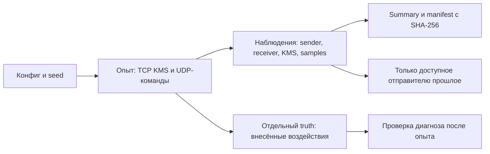

# Воспроизводимые опыты: сеть и KMS



## Быстрый запуск на MacBook

Из корня репозитория:

```bash
uv sync --extra lab
uv run python -m quantum_link_optimizer.telemetry_lab run \
  --config lab/episodes/slow-kms.json --output artifacts/episodes/slow-kms-01
uv run python -m quantum_link_optimizer.telemetry_lab verify \
  --run artifacts/episodes/slow-kms-01
```

Откройте `summary.md` в каталоге запуска. Для повтора задайте новый каталог.
Loopback использует реальные TCP/UDP-сокеты, один процесс и программный UDP-relay.
Это функциональная проверка агентов; Linux namespaces/qdisc проверяются отдельно
по [инструкции стенда](../lab/network.md).

| Конфиг `lab/episodes/` | Что проверяем |
| --- | --- |
| `normal.json` | Доставка и две ротации без воздействий |
| `slow-network.json` | 40 мс туда и обратно, быстрый KMS |
| `slow-kms.json` | Быстрая сеть, 80 мс обслуживания KMS-запроса |
| `empty-pool.json` | Дедлайн истекает при ожидании ключа |
| `lost-ack.json` | Первый ACK пропущен, повтор не исполняет команду второй раз |
| `rotation.json` | Начальный запас заканчивается, обязательная ротация ждёт пополнения |
| `heldout-burst.json` | Отложенная нагрузка и случайные потери пакетов |
| `heldout-rotation.json` | Отложенная нагрузка, остановка пополнения |

Последние два эпизода имеют `split: final_test` и отдельный seed.
Они не запускаются обычной командой без `--final-test`. Их результаты не
используем для настройки правил/моделей; выполняем после фиксации политики.
Имя `heldout-burst` обозначает пачку команд; потери в relay независимые,
не Gilbert–Elliott. Криптографические ключи и nonce случайны независимо от seed.

## Что сохраняется

```text
<run>/
├── scenario.json          # точные параметры опыта
├── source.zip             # снимок Python, конфигов, pyproject и lock
├── sender.jsonl           # команды, попытки, ACK, завершения
├── receiver.jsonl         # приём, исполнение, дубликаты, ACK
├── kms.jsonl              # выдачи, ожидания, состояние без материала ключей
├── samples.jsonl          # состояние KMS, очереди агентов, CPU процесса
├── truth.jsonl            # истинные внесённые воздействия
├── receiver.sqlite        # тестовое состояние и дедупликация
├── summary.json / .md     # статусы, RTT ACK, ожидание ключа по фазам
└── manifest.json          # версии, commit, dirty, seed, SHA-256 файлов
```

Linux runner также сохраняет топологию, PCAP и `queues.jsonl`: qdisc
backlog/drops/overlimits, счётчики интерфейсов, CPU ticks/RSS процессов каждого
namespace. Это накопленные счётчики; для загрузки нужны разности по времени.
Сэмплы содержат начало и завершение сбора. Истинные воздействия — отдельно в
`truth-network.jsonl` и `kms.truth.jsonl`. KMS периодически пишет состояние.
Общий kernel load не выдаётся за независимую загрузку namespaces.

`verify` проверяет целостность файлов, а не правильность сетевого эффекта.
Manifest не подписан: SHA-256 обнаруживает случайные изменения, не защищает
от подмены самого manifest. Исходный `dirty` сохраняется вместе со снимком кода.
Топология loopback записана в manifest; Linux — ещё и в `topology.json`/snapshot.

## Время и доступность

У событий есть `occurred_ns`, `available_ns`, порядковый `record_id` и source.
Для приёма записано фактическое время получения до очереди/KMS. Для команд
сохраняются deadline, отправки попыток и завершение; key ID связывает журнал KMS
с попытками, материал ключей не пишется. `attempt` связывает пакет с ACK.

`algorithm_available_ns` задан только для локального журнала sender.
Receiver/KMS/samples остаются `null`: нет канала доставки их наблюдений
алгоритму. `available_to_sender()` читает только sender и отсекает будущее.
Truth, manifest и конфиг с воздействиями не используются как признаки.
Общий монотонный clock допустим только в пределах одного хоста/VM.

Отсутствие завершения перечислено в `missing_completion`. Отсутствие ACK —
не доказательство потери команды: исход отмечен `unknown`, проверяется по
журналу исполнения. RTT после повторов учитывается только при совпадении
номера подтверждённой и последней отправленной попытки.
В loopback нет qdisc/отдельной загрузки узлов: поля `null` с причиной `missing`.
Seed воспроизводит настройки/псевдослучайные воздействия, не расписание ОС.

## Проверки

```bash
uv run pytest -q tests/kms tests/commands tests/telemetry_lab tests/lab
```

Проверяются TCP/UDP обмен, ротация, дубликаты/restart, очереди, дедлайны,
разделение наблюдений/truth, отсутствие будущих данных, хеши и сохранение
manifest при ошибке. Linux-тесты требуют root и сетевых инструментов.
Root Linux подтверждён CI приёмки; локальная Lima не является источником этих результатов.


## Следующий этап: единый контракт данных

Общий конверт: `schema_version`, `event_id`, `source_id`, `run_id`, `entity_id`,
`topology_version`, `generated_at`, `observed_at`, `algorithm_available_at`,
`clock_domain`, `clock_uncertainty`, `unit`, `quality`, `provenance`.
Идентификаторы сообщения/потока/попытки и policy version добавляются при наличии.
Внутри хоста длительности измеряем monotonic-часами; между хостами храним UTC
с оценкой ошибки. One-way не публикуем как точное значение без достаточной синхронизации.

| Поток | Поля | Где брать | Начальная частота / хранение |
| --- | --- | --- | --- |
| Спрос приложения | submitted messages/bytes, размер, приоритет, deadline, отказ допуска | Агент / генератор нагрузки | Каждое событие; агрегации 1 с |
| Очереди агентов | packets/bytes, limit, oldest age, enqueue/dequeue, wait, rejected | Sender/receiver | События и снимки 100–1000 мс на стенде |
| Интерфейсы | RX/TX bytes/packets, errors/discards, oper state, speed/limit, reset/discontinuity | Linux netlink; позже SNMP/gNMI/NETCONF при поддержке | Начать с 1 с; фактический интервал хранить |
| Очереди QoS | queue/class ID, backlog, limit, high watermark, drops, ECN, sojourn при поддержке | tc; адаптер оборудования | 100 мс на стенде; устройство — по возможностям |
| Потоки | tuple/псевдоним, направление, байты/пакеты, класс, путь | Агент; позже IPFIX/sFlow | События/оконные записи; sampling rate обязателен |
| Пробы | seq, size, protocol, DSCP, send/receive/available, timeout/late, RTT, path | UDP echo; позже STAMP/ICMP | Сценарии 100–250 мс; бюджет измерительного трафика |
| Доставка | message/attempt/copy ID, accepted/executed/ACK, retry, duplicate, expired, unknown | Оба конечных агента | Каждое событие |
| Узлы и обработка | CPU/RSS, event-loop lag, service time, restart, disk pressure | Агент / системные датчики | 1 с плюс события |
| KMS / QKD | запас, выдача/ожидание, refill/consumption, errors; QBER/SKR/attenuation только из отдельного источника | Макет; разрешённый API оператора | События + 1 с; без ключевого материала |
| Часы | offset estimate, uncertainty, state, source, changes, alarms | BC/PTP-монитор | 1 с и события; единицы нс |
| Оборудование и среда | optical RX/TX, FEC/CRC, temperature, power, firmware, maintenance; погода с координатами | Датчики и журналы эксплуатации | 10–60 с и события; интервалы калибровать |
| Изменения / безопасность | config diff/hash, actor, auth failures, IDS alerts, integrity errors | Контроллер и разрешённые источники защиты | Каждое событие; разграничение доступа |

Это стартовые настройки эксперимента, не подтверждённые возможности оборудования.
Недоступное значение — `null` с причиной, а не ноль; редкий опрос не выявляет
все микровсплески. Накопленные счётчики сохраняем вместе с boot/reset ID;
скорость считаем только по корректным разностям и реальному интервалу.

Различаем offered load, admitted load, переданные байты и goodput уникальных
полезных данных. Utilization рассчитываем относительно явно указанной ёмкости
или shaping limit; для неизвестной ёмкости процент не выдумываем. Учёт заголовков,
ACK, проб, копий и повторов сохраняем раздельно. История «до/после» содержит
окна 1 с / 10 с / 1 мин, baseline по режиму нагрузки и события смены политики.

### Потери и неизвестные исходы

Разделяем packet loss, опоздание, reorder, duplicate, corruption/auth failure,
потерю ACK и окончательную недоставку сообщения. Пропуск sequence ID сначала
ожидает окно переупорядочивания. В конце опыта выполняем drain/reconciliation;
граница наблюдения и неразрешённые исходы видны в отчёте. Исполнение без ACK
остаётся unknown для онлайн-агента, даже если постфактум журнал receiver его подтвердил.

Loss ratio считаем на сопоставимом наборе уникальных отправок/приёмов в одном
направлении с определённым timeout; счётчики разных потоков и несогласованных
окон не вычитаем. У sampled-телеметрии указываем метод оценки. Причину локального
drop можно подтвердить счётчиком/событием; timeout с конца пути причины не устанавливает.

### Хранилище и качество

Сначала JSONL для событий, SQLite для каталога/инцидентов, Parquet для аналитики
после измерения объёма. Новая зависимость добавляется отдельным решением.
Брокер и распределённое хранилище вводятся при измеренной потребности.

Предварительная политика: raw 14 дней, секундные агрегаты 90 дней, минутные
агрегаты 1 год; уточнить по объёму, договору и правам. Эталонные эксперименты
хранить по manifest отдельно от кольцевого operational-хранилища. Сначала замерить
bytes/event, events/s, место и накладные расходы, затем утвердить сроки.
Сборщик имеет bounded buffer, счётчик своих потерь и backpressure; сбой аналитики
не блокирует передачу. Полезную нагрузку и ключи не записывать; диагностический
capture ограничивать по сроку, размеру и разрешённым интерфейсам.

Приёмка качества: дубликаты ID, пропуски, freshness, schema drift, reset counters,
отрицательные длительности, нарушение порядка доступности и broken references
выявляются автоматически. Unknown и неполное покрытие показываются отдельно.

