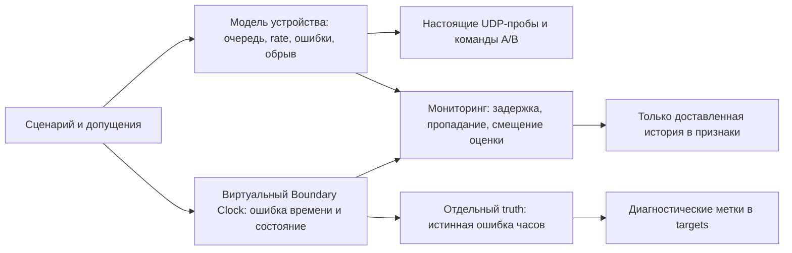

# Деградация оборудования и Boundary Clocks

Дополнение к [сбору датасета](optimizer-dataset.md). Все числовые параметры —
**допущения**, не измерения МКС и не нормативные пределы оборудования.
Они раскрыты в `scenario.json`, сохранены в `manifest.assumptions` и manifest
датасета. Конфиг без явного `status: assumption` отклоняется.



## Сценарии

| Профиль | Воздействие |
| --- | --- |
| `equipment-gradual-a` | Задержка обработки A растёт ступенями 20/80/160/320 мс на направление; температура задаётся отдельно |
| `equipment-rate-a` | Снижение эмулируемой скорости до 0,002 Мбит/с, конечная очередь и восстановление |
| `equipment-outage-a` | Отключение и восстановление устройства A |
| `equipment-shared-outage` | Один общий объект устройства для A/B; отказ влияет на обе ветви |
| `bc-holdover-a` | Потеря привязки к источнику: holdover, дрейф, рост неопределённости, relock |
| `bc-step-a` | Скачок ошибки часов A на 50 000 нс и восстановление |
| `bc-source-switch-a` | Смена источника gm-1 → gm-2, переходный relocking |
| `bc-monitor-gap-a` | Телеметрия часов пропадает, часы переходят в freerun; старые сведения устаревают |
| `bc-common-loss` | Один общий объект часов для обеих ветвей теряет синхронизацию |
| `bc-biased-monitor-a` | Истинная ошибка 50 000 нс скрыта смещённой оценкой монитора |

Эпизоды начинаются с RTT около 60 мс на A/B. В постепенной деградации
добавка 320 мс туда и обратно приближает RTT A к 700 мс, B остаётся быстрым.
Масштабирование времени сжато: это сценарий развития дефекта, не кривая
физического старения. Температура не преобразуется в задержку формулой.
0,002 Мбит/с — лабораторный масштаб для малых пакетов, не скорость согласования
реального порта. Числа требуют калибровки по устройствам и трассам.

## Запуск

```bash
uv run python -m quantum_link_optimizer.collection plan --plan lab/datasets/equipment-clocks.json
uv run python -m quantum_link_optimizer.collection collect \
  --plan lab/datasets/equipment-clocks-smoke.json --splits train validation \
  --output artifacts/datasets/components-smoke
uv run python -m quantum_link_optimizer.collection build \
  --series artifacts/datasets/components-smoke --output artifacts/datasets/components-features
```

Полный план `equipment-clocks.json`: 240 эпизодов по 600 с, около 40 часов
измерений (120 train, 40 validation, 80 final). Единый план
`optimizer-full.json` объединяет прежние сетевые и новые профили: 384 эпизода,
около 64 часов, с теми же правилами изоляции выборок. В команде выше используется
короткий smoke. Final собирается отдельно после freeze, как в основной инструкции.
Длительные серии и финальный тест в рамках разработки не выполнялись.

## Новые данные

- `component_observation` в sender: отчёт устройства и/или часов, время измерения
  `generated_ns` и время фактической доставки `algorithm_available_ns`.
- Признаки устройства: доступность, скорость, backlog в байтах, накопленные
  drops по причинам и температура. Пробы и команды используют общую очередь
  устройства, прямое и обратное направления имеют отдельные очереди.
- Признаки BC: оценка offset и неопределённость в **нс**, reported usable,
  число смен источника, one-hot состояния. У обоих компонентов есть возраст,
  признаки отсутствия и устаревания; устаревшие значения маскируются `null`.
- Истинные offset, состояние отказа и внесённые изменения остаются в truth.
  Метки `bc_actual_offset_ns_at_decision`, `bc_within_budget_at_decision` и
  `device_available_at_decision`, `bc_state_at_decision` и
  `bc_sync_usable_at_decision` описывают состояние в момент решения.
  Они не являются признаками и не подменяют будущие RTT/исход команды.
- `quality.json` считает диагностические метки, превышения бюджета часов и
  устаревшие строки. Допущения сохраняются также в происхождении датасета.

Старая, поздно доставленная телеметрия не заменяет более новое измерение.
Возраст считается от измерения, а не доставки; truth никогда не проходит
через канал наблюдений. Признаки имеют **schema v2**. Старые raw-журналы можно
пересобрать: новые поля без измерений останутся отсутствующими. Preprocessing
и policy lock предыдущей схемы нужно пересоздать; final не переобучает статистики.

## Что означает модель часов

`offset(t) = offset(anchor) + drift_ppb × elapsed_seconds`, где offset — нс.
Бюджет 1000 нс, дрейф 500 ppb, неопределённость 50 нс и задержка мониторинга
150 мс выбраны для лабораторных опытов. Это не характеристики ваших BC.
Монитор выдаёт offset с отдельно заданным bias; он может ошибочно сообщать
о пригодности. Один такой отчёт не доказывает корректность синхронизации.

Состояние часов **не добавляет задержку к RTT** и не меняет monotonic-часы
приложения/ОС. Возможен низкий RTT при непригодной синхронизации. Предел качества
времени и дедлайн команды 100 мс — разные требования. В этом этапе ошибка BC
не блокирует исполнение команд: это отдельное условие пригодности, для которого
нужно подтвердить прикладную политику. Измерения one-way delay не подделываются.

Это функциональная модель, без PTP-пакетов, BMCA, servo, PHC и аппаратных
таймстампов. Изменения скорости действуют на новые резервации передачи;
перепланирование уже зарезервированных пакетов не выполняется. При отключении
очереди сбрасываются, ранее запланированные пакеты не оживают после восстановления.
Мониторинг считается независимым каналом управления; комбинированные отказы
нужно задать явно. Linux namespaces/netem эта модель не заменяет.

Источники терминологии: [LinuxPTP ptp4l](https://www.linuxptp.org/documentation/ptp4l/),
[ITU-T G.8275.1: holdover и качество времени](https://www.itu.int/epublications/publication/itu-t-g-8275-1-y-1369-1-2022-amd-2-2024-08).
Эти источники не подтверждают числовые параметры нашего макета.

Проверки: `uv run pytest -q tests/incidents tests/collection`.

Контрольный smoke сохранён в `artifacts/datasets/equipment-clock-smoke-v2/`,
признаки — `artifacts/datasets/equipment-clock-features-v2/`: 12 эпизодов,
144 train-строки и 96 validation-строк, 60 исходов команд. Получены метки
ошибки часов и устаревания мониторинга; хеши датасета проверены. Это проверка
механизмов макета, не калибровка по реальным устройствам.
