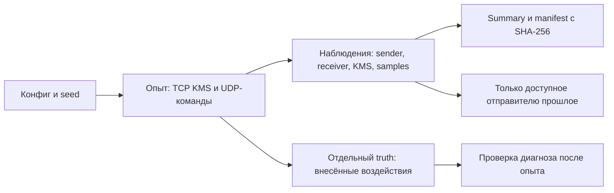

# Воспроизводимые опыты: сеть и KMS



## Быстрый запуск на MacBook

Из корня репозитория:

```bash
uv sync --extra lab
uv run python -m quantum_link_optimizer.telemetry_lab run \
  --config lab/episodes/slow-kms.json --output artifacts/episodes/slow-kms-01
uv run python -m quantum_link_optimizer.telemetry_lab verify \
  --run artifacts/episodes/slow-kms-01
```

Откройте `summary.md` в каталоге запуска. Для повтора задайте новый каталог.
Loopback использует реальные TCP/UDP-сокеты, один процесс и программный UDP-relay.
Это функциональная проверка агентов; Linux namespaces/qdisc проверяются отдельно
по [инструкции стенда](packet-lab.md).

| Конфиг `lab/episodes/` | Что проверяем |
| --- | --- |
| `normal.json` | Доставка и две ротации без воздействий |
| `slow-network.json` | 40 мс туда и обратно, быстрый KMS |
| `slow-kms.json` | Быстрая сеть, 80 мс обслуживания KMS-запроса |
| `empty-pool.json` | Дедлайн истекает при ожидании ключа |
| `lost-ack.json` | Первый ACK пропущен, повтор не исполняет команду второй раз |
| `rotation.json` | Начальный запас заканчивается, обязательная ротация ждёт пополнения |
| `heldout-burst.json` | Отложенная нагрузка и случайные потери пакетов |
| `heldout-rotation.json` | Отложенная нагрузка, остановка пополнения |

Последние два эпизода имеют `split: final_test` и отдельный seed.
Они не запускаются обычной командой без `--final-test`. Их результаты не
используем для настройки правил/моделей; выполняем после фиксации политики.
Имя `heldout-burst` обозначает пачку команд; потери в relay независимые,
не Gilbert–Elliott. Криптографические ключи и nonce случайны независимо от seed.

## Что сохраняется

```text
<run>/
├── scenario.json          # точные параметры опыта
├── source.zip             # снимок Python, конфигов, pyproject и lock
├── sender.jsonl           # команды, попытки, ACK, завершения
├── receiver.jsonl         # приём, исполнение, дубликаты, ACK
├── kms.jsonl              # выдачи, ожидания, состояние без материала ключей
├── samples.jsonl          # состояние KMS, очереди агентов, CPU процесса
├── truth.jsonl            # истинные внесённые воздействия
├── receiver.sqlite        # тестовое состояние и дедупликация
├── summary.json / .md     # статусы, RTT ACK, ожидание ключа по фазам
└── manifest.json          # версии, commit, dirty, seed, SHA-256 файлов
```

Linux runner также сохраняет топологию, PCAP и `queues.jsonl`: qdisc
backlog/drops/overlimits, счётчики интерфейсов, CPU ticks/RSS процессов каждого
namespace. Это накопленные счётчики; для загрузки нужны разности по времени.
Сэмплы содержат начало и завершение сбора. Истинные воздействия — отдельно в
`truth-network.jsonl` и `kms.truth.jsonl`. KMS периодически пишет состояние.
Общий kernel load не выдаётся за независимую загрузку namespaces.

`verify` проверяет целостность файлов, а не правильность сетевого эффекта.
Manifest не подписан: SHA-256 обнаруживает случайные изменения, не защищает
от подмены самого manifest. Исходный `dirty` сохраняется вместе со снимком кода.
Топология loopback записана в manifest; Linux — ещё и в `topology.json`/snapshot.

## Время и доступность

У событий есть `occurred_ns`, `available_ns`, порядковый `record_id` и source.
Для приёма записано фактическое время получения до очереди/KMS. Для команд
сохраняются deadline, отправки попыток и завершение; key ID связывает журнал KMS
с попытками, материал ключей не пишется. `attempt` связывает пакет с ACK.

`algorithm_available_ns` задан только для локального журнала sender.
Receiver/KMS/samples остаются `null`: нет канала доставки их наблюдений
алгоритму. `available_to_sender()` читает только sender и отсекает будущее.
Truth, manifest и конфиг с воздействиями не используются как признаки.
Общий монотонный clock допустим только в пределах одного хоста/VM.

Отсутствие завершения перечислено в `missing_completion`. Отсутствие ACK —
не доказательство потери команды: исход отмечен `unknown`, проверяется по
журналу исполнения. RTT после повторов учитывается только при совпадении
номера подтверждённой и последней отправленной попытки.
В loopback нет qdisc/отдельной загрузки узлов: поля `null` с причиной `missing`.
Seed воспроизводит настройки/псевдослучайные воздействия, не расписание ОС.

## Проверки

```bash
uv run pytest -q tests/kms tests/commands tests/telemetry_lab tests/lab
```

Проверяются TCP/UDP обмен, ротация, дубликаты/restart, очереди, дедлайны,
разделение наблюдений/truth, отсутствие будущих данных, хеши и сохранение
manifest при ошибке. Linux-тесты требуют root и сетевых инструментов.
Пока VM не запущена из-за нехватки места, их результаты остаются непроверенными.

## Локальная проверка 2026-11-04

Один контрольный прогон, 12 команд (пустой пул — 4). Эти числа служат
проверкой механизма, не оценкой производительности целевой сети.

| Эпизод | Исполнения | ACK до дедлайна | Медиана RTT ACK | Стартовое ожидание ключа |
| --- | --- | --- | --- | --- |
| Норма | 12 | 12 | 0,81 мс | 1,44 мс |
| Медленная сеть | 12 | 12 | 85,93 мс | 0,71 мс |
| Медленный KMS | 12 | 12 | 0,71 мс | 80,91 мс |
| Пустой пул | 0 | 0 | нет ACK | timeout |
| Потеря первого ACK | 12 | 12 | 0,70 мс | 0,68 мс |

Локальные артефакты: `artifacts/episodes/*-review/` (вне Git).
Хеши проверены. Отложенные эпизоды не запускались.

Парный сбор A/B, признаки и разбиение под 700 → 100 мс: [датасет оптимизатора](optimizer-dataset.md).
