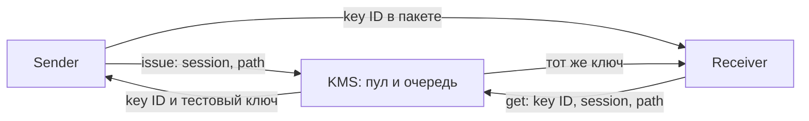

# Макет KMS

Тестовые 32-байтовые ключи. Один `issue` расходует единицу пула;
`get(key_id, session, path)` выдаёт второй стороне тот же материал без нового расхода.
Политика ротации принадлежит клиентской сессии, не отдельному пакету.



```bash
PYTHONPATH=src python3 -m quantum_link_optimizer.kms \
  --config lab/kms/normal.json --events /tmp/kms-events.jsonl
```

Файл событий должен быть новым. API: JSON-строка поверх TCP, по умолчанию
`127.0.0.1:9400`. Это доверенный лабораторный канал с тестовыми ключами,
без TLS и аутентификации; нельзя публиковать его в недоверенную сеть.
Материал ключей не записывается в журнал; сетевой capture канала API
содержал бы материал, поэтому этот канал нельзя включать в сохраняемый PCAP.

| Конфиг `lab/kms/` | Сценарий |
| --- | --- |
| `normal.json` | Общий запас A/B, пополнение 1 ключ/с |
| `separate.json` | Отдельный запас каждой ветви |
| `slow.json` | 150 мс обслуживания каждого API-запроса |
| `empty.json` | Пустой пул без пополнения, ожидание до timeout |
| `no-refill.json` | Остановка пополнения через 2 с |
| `unavailable.json` | API недоступно с 2 до 5 с |

`queue_limit` ограничивает все принятые запросы, включая обслуживаемый.
Обслуживание сериализовано. Ожидание пустого пула освобождает worker,
чтобы `get` ранее выданного ключа продолжал работать. Клиент задаёт timeout.
Ключи хранятся до `key_ttl_s`, число записей ограничено `retained_limit`.
При рестарте KMS запас и ключи сбрасываются; неизвестный ID возвращает ошибку.

Проверки: `uv run pytest -q tests/kms`. Проверяются согласованность сторон,
общий/раздельный расход, пополнение, истечение, переполнение очереди,
отмена, timeout, недоступность и ошибочный ID. QBER/SKR не моделируются.
