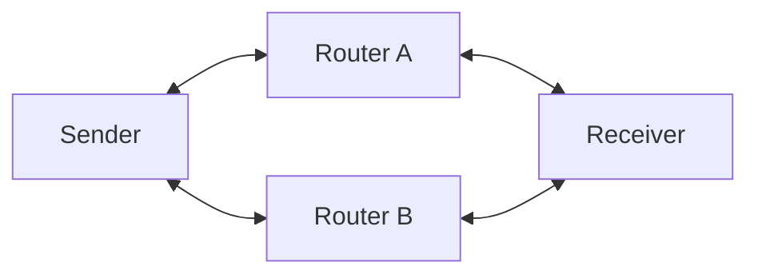
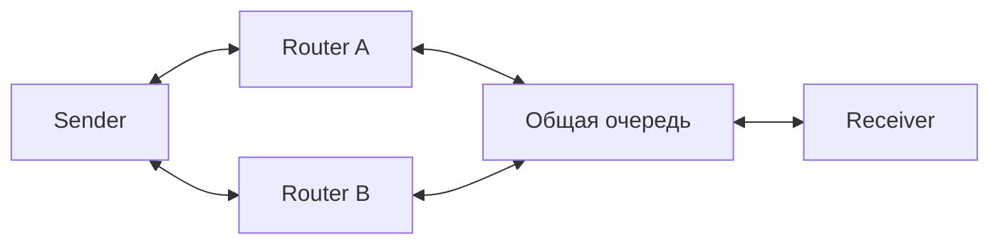

# Пакетный стенд A/B

Linux namespaces и veth внутри одной VM. Настройки направлений независимы.
Данные лабораторные; физическая QKD и KMS пока не моделируются.



Общий участок: один шейпер C → R ограничивает сумму A+B.



## MacBook

```bash
brew install lima
limactl start --name=qkd-lab --vm-type=vz --cpus=4 --memory=4 --disk=20 template:ubuntu
limactl shell qkd-lab
```

В Linux VM установите зависимости и скопируйте репозиторий с нужной веткой:

```bash
sudo apt-get update
sudo apt-get install -y iproute2 iputils-ping iperf3 tcpdump python3
sudo modprobe sch_netem
```

Из корня репозитория в VM, без установки PyTorch:

```bash
sudo env PYTHONPATH=src python3 -m quantum_link_optimizer.lab doctor
sudo env PYTHONPATH=src python3 -m quantum_link_optimizer.lab run \
  --config lab/scenarios/baseline.json --output artifacts/lab/baseline-01
```

Новый запуск требует новый выходной каталог. `run` автоматически удаляет свои
namespaces и останавливает процессы, в том числе при ошибке и Ctrl+C.
SIGKILL и выключение VM обойти штатную очистку могут: имена оставшихся ресурсов
есть в `topology.json`; удаляйте только ресурсы своего запуска.

## Сценарии

| Конфиг в `lab/scenarios/` | Воздействие | Проверка |
| --- | --- | --- |
| `baseline.json` | 10 мс в каждую сторону A/B | RTT около baseline VM +20 мс |
| `asymmetric.json` | A: 40 мс туда, 60 обратно | RTT A около baseline +100 мс |
| `congest-a.json` | A: 10 Мбит/с, фон 15 Мбит/с | Backlog/RTT A растут, B здоров |
| `shared-bottleneck.json` | Общие 10 Мбит/с, фон A+B 16 Мбит/с | Общая очередь, ухудшение A и B |
| `outage-a.json` | A down на 10 с, up на 15 с | Пропуски A в окне, B работает |
| `loss-a.json` | A: случайные потери 5% вперёд | Потери A на достаточной выборке |
| `reorder-a.json` | A: delay 30 мс, reorder 10% | Порядок ICMP sequence в PCAP |
| `bad-reverse-a.json` | A: 90 мс обратно вместо 10 | RTT A увеличивается примерно на 80 мс |

В этой версии используются ICMP-пробы и UDP-фон iperf3. Фон работает всю
измерительную фазу. Времена событий считаются от запуска нагрузки;
фактические времена записываются. Частота сбора очередей — около 100 мс.
TBF ограничивает скорость, дочерний netem задаёт задержку и лимит пакетов;
его очередь заменяет внутреннюю очередь TBF. Точность зависит от таймеров VM.

## Результаты

В `artifacts/lab/<запуск>/`: конфиг, manifest с версиями/commit/dirty,
топология, начальные/финальные маршруты и qdisc, `queues.jsonl`, `events.jsonl`,
логи ping/iperf3 и PCAP каждого namespace. В журнале tcpdump проверьте потери
самого capture. Захват `any` может показывать один пакет на нескольких интерфейсах.

Статус `collected` означает завершённый сбор, а не автоматическую приёмку.
Проверьте ветви по интерфейсам PCAP, сопоставьте события с RTT и backlog.
Проведите минимум три повтора; одинаковые параметры не гарантируют одинаковые
пакеты. Seed пока не задаётся. Offload и планировщик VM могут влиять на результат.
Commit с `dirty` не восстанавливает незакоммиченный код — для сравнения нужен
чистый checkout. Поведение при SIGKILL требует ручной проверки ресурсов.

## Следующие этапы

- UDP echo с sequence ID, независимым расписанием и учётом поздних ответов.
- Seed, burst loss, прогрев и расписание фоновой нагрузки.
- Автоматический `verify`, разрешённый конфиг, управление оставшимися ресурсами.
- Калибровка offload/очередей и диагностика по наблюдениям.
- Макет KMS и сравнение алгоритмов после приёмки сети.

Документация: [netem](https://man7.org/linux/man-pages/man8/tc-netem.8.html),
[Lima](https://lima-vm.io/docs/usage/).

## Состояние проверки — 2026-11-04

Локальные тесты и Ruff пройдены на macOS. Linux-интеграционные тесты проверяют
обе топологии, прибавку RTT, разделение ветвей по PCAP и очистку после ошибки.
Они пока не выполнены: загрузка Ubuntu через Lima завершилась ошибкой
`no space left on device`. На MacBook осталось около 463 МиБ.
Перед Linux-прогоном нужно освободить место под образ, диск VM и PCAP.
Lima установлена; VM `qkd-lab` создана, но ещё не запущена.

В подготовленной Linux VM интеграционные тесты запускаются из корня репозитория:

```bash
sudo apt-get install -y python3-pytest
sudo env PYTHONPATH=src python3 -m pytest -q tests/lab
```
